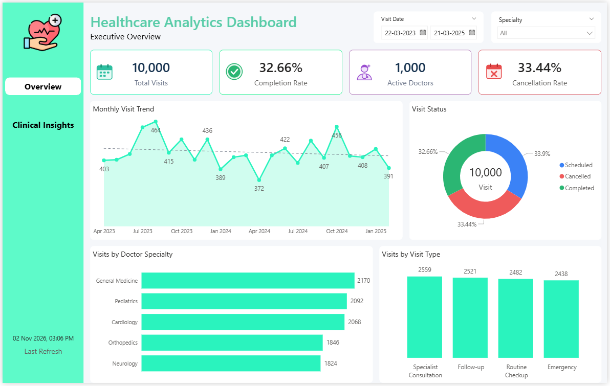
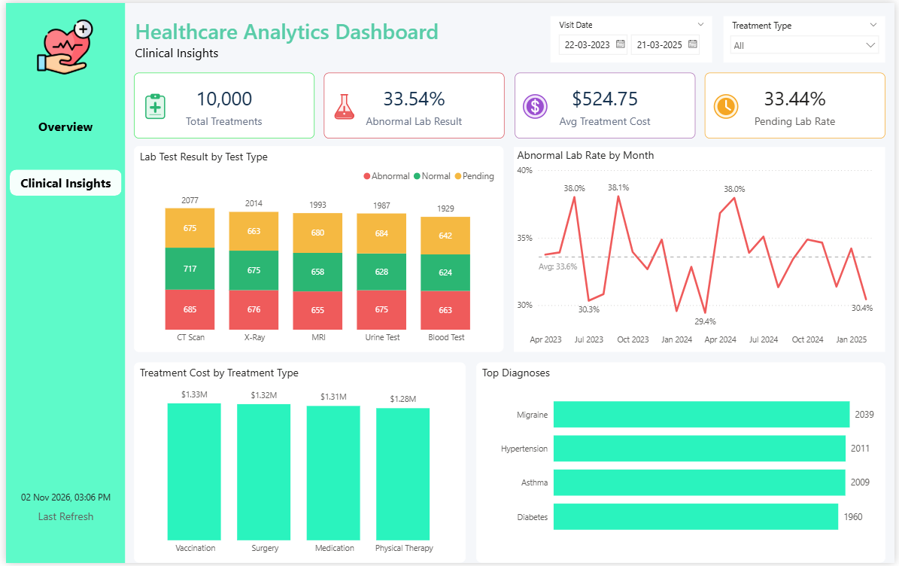

# Healthcare Analytics Dashboard (Power BI)

An interactive two-page Power BI dashboard built on the Exon Healthcare dataset. It gives an executive view of patient visits and a clinical view of treatments, lab results and diagnoses.

## Dashboard Preview

| Overview | Clinical Insights |

 

## Objectives
- Track visit volume, completion and cancellation across the period
- Understand workload by doctor specialty and visit type
- Monitor lab test outcomes, treatment costs and common diagnoses
- Let users filter every view by date, specialty and treatment type

## Dataset
Exon Healthcare dataset (CSV files), covering visits from **22 Mar 2023 to 21 Mar 2025**.

| Table | Description |
|---|---|
| `healthcare_analytics patient` | Patient demographics |
| `healthcare_analytics doctor` | Doctor details, specialty, hospital/clinic |
| `healthcare_analytics visit` | Visits, status, visit type, diagnosis |
| `healthcare_analytics treatments` | Treatments, cost, outcome |
| `healthcare_analytics lab-result` | Lab tests and results |
| `Treatment Type` | Dimension table used by the Treatment Type slicer |

Approximate size: 10,000 patients, 1,000 doctors, 10,000 visits, 10,000 treatments and 10,000 lab tests.

## Data Model
- Patient → Visit (one-to-many)
- Doctor → Visit (one-to-many)
- Visit → Lab Result (one-to-many)
- Visit ↔ Treatments (one-to-many, cross-filter direction set to **Both** so the Treatment Type slicer filters visits, lab results and diagnoses)
- Treatment Type → Treatments (one-to-many)

## Dashboard Pages

### 1. Overview (Executive)
**KPIs:** Total Visits, Completion Rate, Active Doctors, Cancellation Rate

**Visuals:**
- Monthly Visit Trend (partial months excluded, with trend line)
- Visit Status (donut)
- Visits by Doctor Specialty
- Visits by Visit Type

**Slicers:** Visit Date, Specialty

### 2. Clinical Insights
**KPIs:** Total Treatments, Abnormal Lab Result %, Avg Treatment Cost, Pending Lab Rate

**Visuals:**
- Lab Test Result by Test Type
- Abnormal Lab Rate by Month (with average line)
- Treatment Cost by Treatment Type
- Top Diagnoses ("Healthy" excluded)

**Slicers:** Visit Date, Treatment Type

## Key DAX Measures
```DAX
Total Visits = DISTINCTCOUNT ( 'healthcare_analytics visit'[Visit ID] )

Active Doctors =
CALCULATE (
    DISTINCTCOUNT ( 'healthcare_analytics doctor'[Doctor ID] ),
    TREATAS (
        VALUES ( 'healthcare_analytics visit'[Doctor ID] ),
        'healthcare_analytics doctor'[Doctor ID]
    )
)

Completion Rate =
DIVIDE (
    CALCULATE (
        COUNTROWS ( 'healthcare_analytics visit' ),
        'healthcare_analytics visit'[Visit Status] = "Completed"
    ),
    COUNTROWS ( 'healthcare_analytics visit' )
)

Cancellation Rate =
DIVIDE (
    CALCULATE (
        COUNTROWS ( 'healthcare_analytics visit' ),
        'healthcare_analytics visit'[Visit Status] = "Cancelled"
    ),
    COUNTROWS ( 'healthcare_analytics visit' )
)

Abnormal Lab Rate =
DIVIDE (
    CALCULATE (
        COUNTROWS ( 'healthcare_analytics lab-result' ),
        'healthcare_analytics lab-result'[Test Result] = "Abnormal"
    ),
    COUNTROWS ( 'healthcare_analytics lab-result' )
)

Month Start =
DATE (
    YEAR ( 'healthcare_analytics visit'[Visit Date Clean] ),
    MONTH ( 'healthcare_analytics visit'[Visit Date Clean] ),
    1
)
```
Adjust table and column names if your model differs (the lab table, for example, may be named differently).

## Observations
- Visit status splits almost evenly: about 33.9% Scheduled, 33.4% Cancelled and 32.7% Completed.
- Monthly visits stay roughly between 370 and 460, with a near-flat trend.
- About 33.5% of lab results are abnormal, and the monthly rate moves within a narrow band of roughly 29% to 38%.
- Visit types, specialties, diagnoses and treatment costs are all fairly evenly distributed, which is typical of a synthetic dataset.

## Design Notes
- Consistent colour language: green for completed or normal, red for cancelled or abnormal, amber for pending, blue for scheduled
- Custom SVG icons for each KPI card, grouped with the card so they move together
- First and last months excluded from the trend charts because they are partial months

## How to Use
1. Download the CSV files and the `.pbix` file.
2. Open the `.pbix` in Power BI Desktop.
3. If you moved the CSVs, update the paths in **Transform data → Data source settings → Change Source**.
4. Use the slicers to filter by date, specialty or treatment type.

## Tools
- Power BI Desktop (DAX, Power Query, data modelling)
- CSV data sources

## Author

Vaibhav Gharpankar

LinkedIn: https://www.linkedin.com/in/vaibhav-gharpankar-502b37343/
